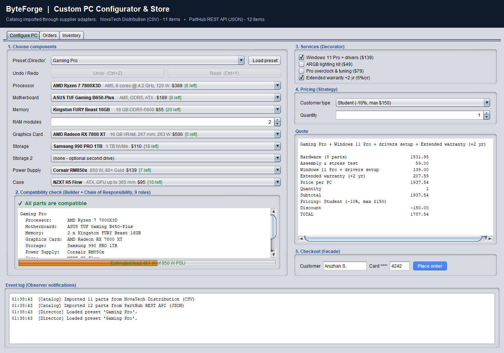
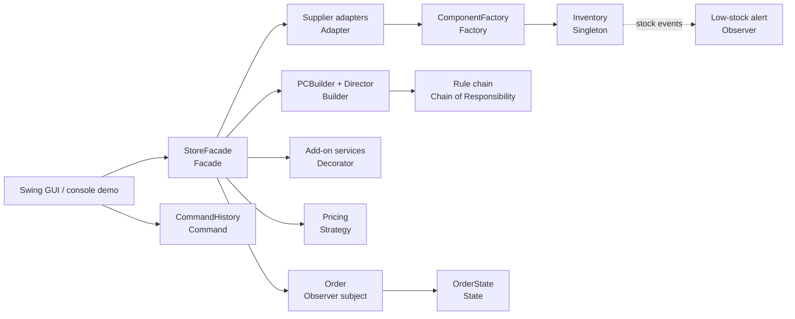
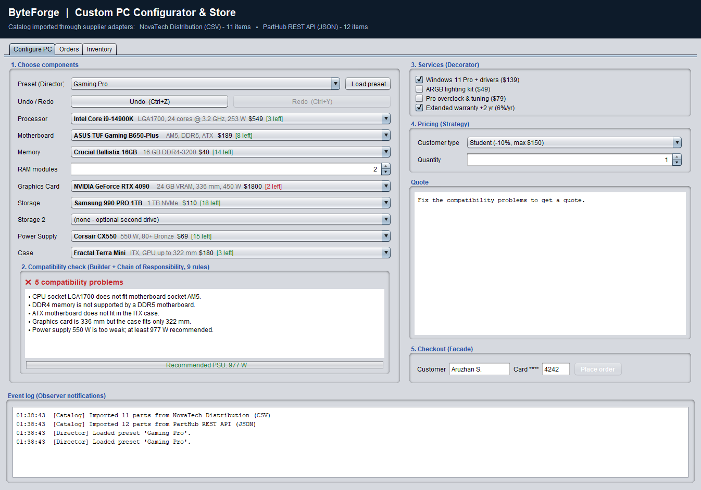
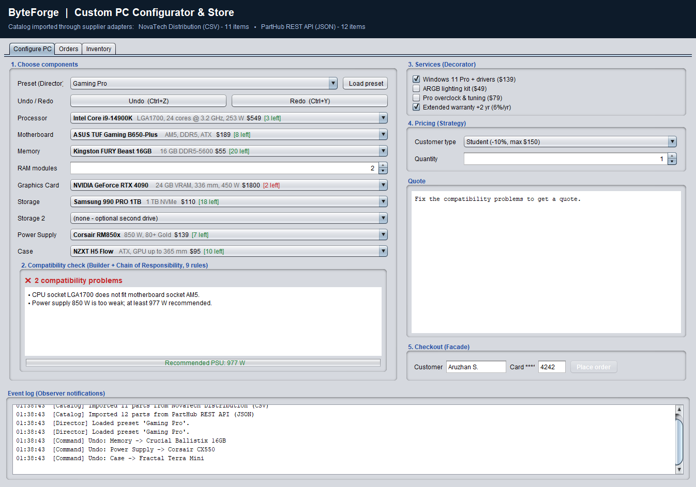
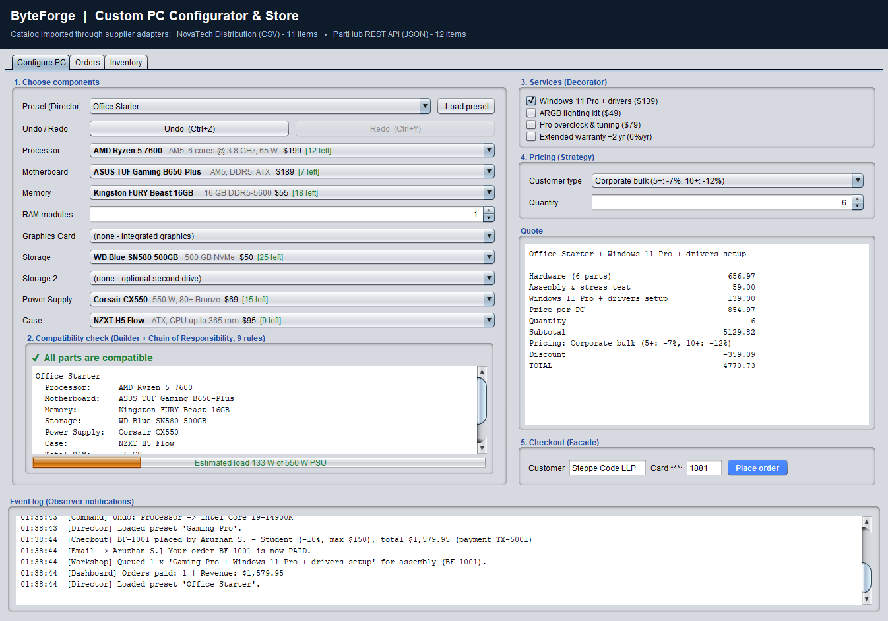
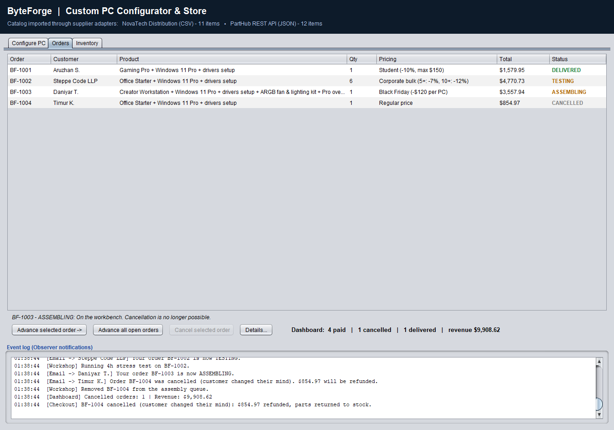
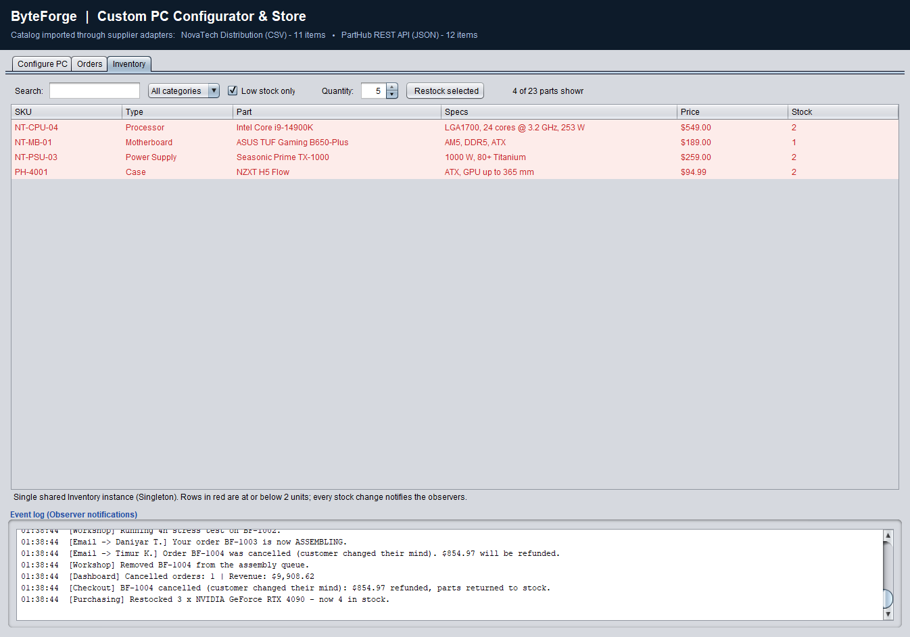
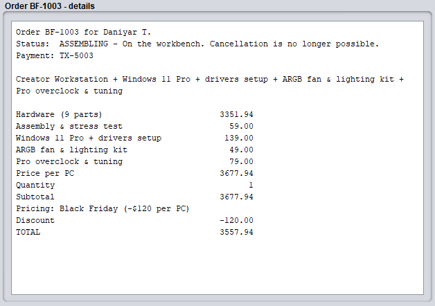

# ByteForge - Custom PC Configurator & Store

Final project for the Software Design Patterns course. A Java Swing application where customers
configure a custom computer, get a live hardware compatibility check, undo/redo their changes,
add services, choose a pricing policy, track and cancel their order. Eleven design patterns work together.

## Design patterns

| Pattern   | Where                                          | Author    |
|-----------|------------------------------------------------|-----------|
| Singleton | `inventory/Inventory`                          | Student 1 |
| Factory   | `factory/ComponentFactory`                     | Student 1 |
| Adapter   | `adapter/*Adapter`, `SupplierFeed`             | Student 1 |
| State     | `state/OrderStates`, `observer/Order`          | Student 1 |
| Builder   | `builder/PCBuilder`, `BuildDirector`           | Student 2 |
| Decorator | `decorator/AddOnDecorator`, `AddOns`           | Student 2 |
| Command   | `command/ConfigCommands`, `CommandHistory`     | Student 2 |
| Chain of Responsibility | `rules/CompatibilityRules`       | Student 3 |
| Strategy  | `strategy/PricingStrategy`                     | Student 3 |
| Observer  | `observer/Order`, `Listeners`                  | Student 3 |
| Facade    | `facade/StoreFacade`                           | Student 3 |

How they work together:

## Run

Requires JDK 11+.

| Command | What it does |
|---|---|
| `run.bat` | start the GUI |
| `run.bat --console` | console demo that walks through every pattern |
| `run.bat --test` | 50 automated tests (no external libraries) |
| `run.bat --screenshots docs\screenshots` | regenerate the report screenshots |

- **IntelliJ IDEA:** open the folder and use the run configurations
  *ByteForge GUI*, *ByteForge Console demo* or *ByteForge Tests*.
- **macOS / Linux:** `javac -d out $(find src test -name "*.java") && java -cp out com.byteforge.Main`

## Things to try

- Load the *Gaming Pro* preset, then pick an Intel CPU and the RTX 4090: the rule chain lists every problem.
- Press Ctrl+Z / Ctrl+Y to undo and redo configuration changes.
- Tick services and switch the customer type to see the quote change.
- Use a card ending in `0000`: the payment is declined and the stock stays unchanged.
- In the Orders tab, cancel a PAID order (refund + parts back to stock); an ASSEMBLING one cannot be cancelled.
  Double-click an order (or press *Details...*) for its full receipt.
- In the Inventory tab, search, filter by category or low stock, and restock parts.

## Screenshots

| | |
|---|---|
|  Rule chain rejects an incompatible build |  Three changes undone with Command |
|  Corporate bulk pricing (Strategy) |  Order states, cancellation and notifications |
|  Shared inventory, low-stock filter and restock |  Order details: decorator line items, payment and state |

## Report

`docs/report/Report.pdf` (the HTML source is `docs/report/Report.html`): introduction, a section
per pattern with UML class diagrams and code, sequence diagrams, screenshots, test results,
conclusion and further work.
